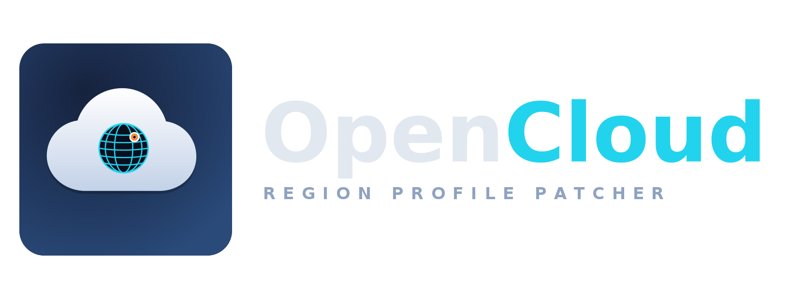

<p align="center">
  
</p>

# OpenCloud

OpenCloud patches a **universal TikTok APK** so the app sees a region profile
chosen by the user. It is a small, independent implementation: no code was
taken from MargyT, and it does not use the Margy/MargyT name or artwork.

The patched build still has TikTok's package name. Uninstall the official
TikTok first, then install the OpenCloud build. A second launcher icon named
**OpenCloud** opens the region settings.

## What it does

- Rewrites telephony call sites in every dex file to a small Java bridge.
- Implements these values from the selected profile:
  - SIM and network country ISO
  - SIM and network operator numeric (`MCC` + `MNC`)
  - SIM and network operator name
  - SIM state, ICC presence and roaming
  - SIM carrier id, phone count, modem count and phone type
  - active subscription count and default subscription ids
  - `SubscriptionInfo.getCountryIso()`
- Adds one extra `classesN.dex` with the bridge and the settings screen.
- Adds an **OpenCloud** launcher activity to the manifest without touching
  TikTok's resource table.
- Makes TikTok use its **browser-based Google login** (`google_web`, AppAuth +
  Custom Tabs) instead of the native Google Sign-In SDK. The native flow
  validates the APK signing certificate, so it cannot work after repackaging;
  the browser flow only needs the registered OAuth redirect scheme, which is
  already in TikTok's manifest.
- Removes `assets/dexopt/baseline.prof` and `.profm`, because they describe
  the original dex files and are no longer valid after patching.
- Aligns and signs the result.

TikTok's own settings screen gets a **"Выбор региона"** row pinned above the
list (the fragment's view is wrapped by `SettingsEntry.decorate`; no Compose
cell or resource is injected). Tapping the row opens the OpenCloud screen.
There the **"Выбор региона"** card opens a dialog where a country and one of
its operators can be picked; the choice is stored and every telephony hook
uses that operator's MCC/MNC and name. The separate **OpenCloud** launcher
icon still works as a fallback.

The toggle in the settings screen is reversible at runtime: when it is off,
every bridge method calls the real framework method again.

## What it does not do

OpenCloud is a region-profile tool, not a general TikTok mod and not an
anti-detection system.

- It does not hide the patched dex, the changed signature or the sideload.
- It does not patch signature checks, Play Integrity, SafetyNet, `X-Argus`,
  `X-Gorgon`, `msToken`, device registration or server-side region checks.
- It does not change `store_region`; that value belongs to the account and is
  set by TikTok's server.
- It does not change the IP address or GPS location. Use a VPN if the network
  location matters.
- It does not cover native/JNI reads, cell-info lists, subscriber ids, device
  ids, line numbers or SIM serial numbers.

If the goal is simply a different region for a new account, a VPN and a new
account are usually enough. OpenCloud only helps when the app itself must see
different telephony values.

## Requirements

- Python 3.10 or newer.
- A full JDK 17 or newer (`java`, `javac`, `keytool`).
- Android SDK with:
  - at least one platform containing `android.jar`;
  - build-tools containing `d8`, `zipalign` and `apksigner`.
- Network access on the first build: `tools/apktool_3.0.3.jar` is downloaded
  and checked against a pinned SHA-256.
- A **universal** TikTok APK: type `APK`, not `BUNDLE`, `arm64-v8a`, `nodpi`.
  Split bundles do not contain a resource table that can be handled this way.

`ANDROID_HOME` (or `ANDROID_SDK_ROOT`) should point at the SDK. If it is not
set, the builder checks `~/android-sdk`, `~/Android/Sdk` and
`/opt/android-sdk`.

## Build

```bash
./build.sh /path/to/tiktok.apk
```

The output is written next to the input with the suffix `-opencloud.apk`.
Useful options:

```bash
./build.sh tiktok.apk -o OpenCloud.apk
./build.sh tiktok.apk --country de
./build.sh tiktok.apk --strict
./build.sh tiktok.apk --allow-missing
./build.sh tiktok.apk --no-settings
./build.sh tiktok.apk --no-sign
```

- `--country` sets the default ISO code from `data/countries.tsv`.
- `--strict` fails if any optional hook has no call site.
- `--allow-missing` turns missing-hook failures into warnings. Use it only
  for a TikTok version whose dex has removed or inlined a field.
- `--no-settings` skips the settings activity; the build uses the default
  country only.
- `--no-sign` leaves the APK unsigned (not installable) and is meant for
  pipeline tests.

The first signed build creates a local key at
`~/.config/opencloud/opencloud.keystore` with password `opencloud`. This is a
development key. Keep it if you want future builds to update the same install;
replace it with your own key for a real release.

## Install

```bash
adb uninstall com.zhiliaoapp.musically
adb install -r /path/to/tiktok-opencloud.apk
```

Then open TikTok → **Settings**: the first row is **"Выбор региона"**. Tap it,
pick a country and operator and press **"Сохранить"**. The same screen is also
available from the separate **OpenCloud** launcher icon. If no profile is
chosen, the build default is used.

## Country table

The table is `data/countries.tsv`, one tab-separated row per operator:

```text
iso<TAB>country name<TAB>MCCMNC<TAB>operator name
```

A country may appear on several rows, one per operator; the settings dialog
lists them in file order. The first row of a country is its default operator.
`MCCMNC` is three digits of MCC followed by a two- or three-digit MNC. The
build validates the ISO code, digits, MCC/MNC uniqueness and the default
country before compiling anything. Edit the file and rebuild to change the
list.

## How the build works

1. Parse the original binary manifest, add the OpenCloud activity and keep
   every existing resource reference intact.
2. Run `apktool d -r` to decode dex files while copying resources and the
   manifest as raw bytes.
3. Match exact telephony method signatures in smali and replace the call with
   a static `Hooks` call. The receiver becomes the first argument; `invoke-
   virtual/range` stays `/range`.
4. Compile the bridge and settings screen with `javac`, convert them to a dex
   with `d8`, and add it as the next free `classesN.dex`.
5. Rebuild with `apktool b`, replace the manifest with the edited binary
   manifest, drop old signatures and baseline profiles, then `zipalign` and
   `apksigner`.

The patcher requires the six core string hooks by default. If a TikTok update
renames or removes one of them, the build fails instead of producing an APK
that silently does nothing. `--allow-missing` overrides that check.

## Tests

```bash
python3 -m unittest discover -s tests
```

The tests cover the binary XML reader/writer, the country table validator and
the smali rewriter. A full APK round-trip needs the Android SDK and an APK;
it is intentionally not part of the unit test run.

## Branding

`assets/branding/` contains the source logo files:

- `opencloud-icon.svg` / `opencloud-icon-1024.png` / `-512.png` / `-256.png`
- `opencloud-logo.svg` / `opencloud-logo.png` (icon + wordmark)

## License

OpenCloud is licensed under the GNU General Public License, version 3 or
later. See `LICENSE`.

OpenCloud is not affiliated with TikTok, ByteDance, Margy or MargyT.
